  
  

  

---

### 🛠️ Tech Stack

<h4>Languages</h4>

  
  
  
  
  
  
  
  
  
  
  
  

<h4>Backend & Microservices</h4>

  
   
  
  
  
  

<h4>Developer Tooling</h4>

  
  

<h4>Virtualization & Systems</h4>

  
  

<h4>Frontend</h4>

  

<h4>Mobile</h4>

  
   
  

<h4>Databases</h4>

  
   
  

<h4>Cloud, DevOps & Tools</h4>

  
   
  
  

<h4>Design</h4>

  
   
  

---

### 🌐 Connect with Me

